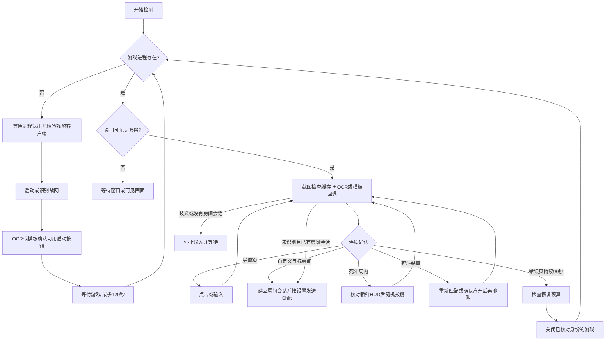

# 架构与协议

版本 0.4.1，目标为 Windows 10/11 x64 国服战网版。实现独立于旧样本，只使用系统公开接口；死斗随机键表与按住时长参考旧样本的静态分析结果。

## 本地线程与资源

Win32 UI 线程处理按钮、校准、全局停止热键和状态刷新；工作线程正常每约 1 秒采集识别、每约 2 秒枚举进程。自定义房间连点期间识别周期缩短到约 200 ms。OCR 请求在工作线程等待独立的隐藏子进程，耗时会延长本轮识别；等待支持停止/代次取消与有界超时。网络线程负责心跳，网络失败不阻塞游戏状态检测。

运行时截图取前台目标窗口的可见客户区，采集接口核对可见性、几何和输入桌面；不读取被遮挡或最小化的画面。DC 和 DIB 按窗口尺寸复用；每个模板在归一化 ROI 中抽取 32×16 灰度值，每格 4 个采样点。手动校准最多 32 个模板，每份模板 512 字节，保存为 INI 中的十六进制文本。

`agent/vision.hpp` 启动系统 Windows PowerShell，运行 EXE 旁的 `ocr-worker.ps1`。工作进程使用 WinRT `Windows.Media.Ocr` 的 `zh-Hans` 引擎，读取本程序生成的 BMP；游戏文字额外做斜体校正并映射回原坐标。普通识别最高放大 2 倍，未命中或识别为 Browser 时补充最高 3 倍详细 OCR 并合并词框，以读取小窗口房间完整标题。共同的结果选择函数在合并未识别出页面时保留有效普通 Browser；不同完整模式造成的歧义仍 Wait，普通 None 可由详细结果恢复。请求/响应通过匿名管道，带请求编号、大小检查、超时和取消；F8 可中止本程序拥有的 OCR 子进程。没有上传图像、调用远端模型或执行旧样本。

国服旧截图预设以 `profiles/cn-16x9.json` 随包提供，也可在配置目录覆盖，同时保留编译进二进制的内置副本。页面标识、动作、点击位置、宽高比、每条规则的阈值、每个锚点的 ROI 与阈值、以及模板字节都在 JSON 数据里，加载顺序为配置目录覆盖 → EXE 旁随包文件 → 内置回退副本。一个锚点可以带多份变体模板，任一变体达标即算通过：同一块界面在不同窗口像素尺寸下会抽出不同的 32×16 样本，变体表达的是一条要求在不同尺寸下的多次观察，而不是不同页面。规则必须每个锚点全部通过才算命中；两个互斥页面的分差不足时判为歧义并放弃。

当前截图仍复制完整客户区。DIB 和帧缓冲合计约占 `宽 × 高 × 8` 字节，不含其他程序内存；这不是进程总内存的实测值。小窗口可以降低截图成本，缩放后的字体和 UI 仍需实机确认识别是否稳定。

## 识别与恢复

0.4.1 的 `core/semantic.hpp` 优先检查自适应图像缓存，未命中则解析 OCR 文本、上下文、唯一候选和按钮颜色状态。启动需守望先锋身份及可用启动按钮，密码表单不自动输入；更新/下载和不可用按钮等待。浏览房间需页面上下文并按目标完整标题分组，全文匹配优先；同完整标题多个实例可以依次尝试，不同完整标题仅共享子串时等待精确目标。卡片和按钮按 OCR 得到的当前位置选择和加入。大斜体页头与“创建游戏”读不到时，必须同时有筛选/搜索栏与顶部人气/收藏/近期/所有标签，两个控件都进入页面证据。底部“浏览游戏 自动加入”被 OCR 合成一行时，Join 仅取加入按钮词框的实际坐标，并核验按钮启用颜色；`UiText::one` 去重同一行嵌套的“自动加入/加入”别名，保留独立按钮候选的歧义检查。OCR 请求之后，无论成功、失败或未识别页面，都重新采集给语义与旧模板回退使用；操作前核对进程身份、尺寸及页面证据，避免把旧截图位置用于已经切换的页面。

OCR 结果经两次页面确认后才保存 `adaptive-profile.json`。缓存最多 64 条，每条至少两个非纯色锚点，匹配同时检查字形相关性与亮度相似度，阈值 0.965；按战网/游戏、工作模式、房间目标和结算/离开阶段隔离，窗口布局不合时重新 OCR。动态局内 HUD、搜索输入、等待状态与 Browser 不学习缓存；已有 Browser 项自动忽略，不参与匹配，避免选卡前后的页头/标题不变而遮住新 Join 状态。Join 缓存和新截图核对完整标题、位置、页面及按钮，不使用全列表精确像素哈希，容许背景光效及无关人数变化；标题改变或卡片移动仍使缓存失效。版本 3 缓存保留可读取的版本 2 其他导航页面，旧 Join 项重新学习。不同按钮位置的校准分别保留。缓存写入采用临时文件替换，读取验证结构、坐标与模板内容。

`core/cn_recovery.hpp` 的旧截图预设和手动校准作为回退。旧预设仍只覆盖已录到的约 16:9 布局及默认目标；非默认房间禁用旧目标导航，死斗禁用旧自定义房间导航。已知错误优先于手动模板；已知导航优先于手动 Ready，及时结束房间会话；歧义暂停。窗口化视频设置页以顶部设置标签和默认设置上下文识别，Escape 返回导航。

`CNJoinGate` 要求本轮成功发送目标卡片选择，15 秒内再次核对后才加入。加入打开 5 秒连点窗口，每 200 ms 一次、单轮最多 25 次；期间每次仍采集识别，但不启动昂贵的 OCR 请求。未知画面立即停止连点而不算成功；仅加入动作后 30 秒内的连续两次正向 Room 观察确认加入。单轮未进房时切换下个同完整标题的房间实例；5 轮无进展后等待 15 秒，再重新选择并尝试。停止、进程变化及已知其他页面撤销加入证据。

“重启游戏”按钮把一次请求绑定到当前运行代次，允许在暂停或缺配置状态重新发起；共用演练、身份核对、退出等待和恢复冷却。关闭前检查客户端绝对路径及启动配置，失败时保留现有游戏。手动请求可在自动恢复关闭时执行一次恢复；F8 撤销旧代次。

战网进程存在但没有可见主窗口时，首次激活阶段也会打开配置的入口以唤起主窗口；120 秒截止时间防止重复拉起。窗口枚举从身份匹配的窗口中优先选择无所属窗口的大客户区，避免选到战网的微小辅助窗口。

手动模板记录目标对象、页面名称、ROI、宽高比、操作位置和操作类型。宽高比偏差超过 3.5% 的模板不参与匹配；相似度阈值默认 0.90。两个互斥合格模板的分差不足 0.025 时判为歧义，不执行动作。同一对象的 Ready、Restart 或 Combat 多个样本作为同类观察，用稳定观察编号连续两帧确认。Ready 模板在原位置得分不足 0.98 时最多尝试 24 个附近偏移（约 1024×576 客户区上 ±2 像素，随整数缩放步长变化）；导航与错误模板保持原位置匹配。

普通导航操作之间至少间隔 5 秒，同一页面最多尝试发送 3 次（包含失败或部分发送）；输入文字最多一次，避免重复提交。确认进入另一个页面后重置前页重试次数。自定义房间会话在连续确认 Ready 后保留；未知画面不清除既有会话，但不能建立新会话；已知导航/错误、歧义或进程变化立即清除。默认 keybd_event 左 Shift 点按，20 ms 后抬起，每约 1 秒发送一次。所有模式的输入仅在目标位于前台、普通交互桌面、当前运行代次有效时发送；失焦、停止和退出释放自有按键。

`core/deathmatch.hpp` 使用独立会话管理匹配、局内、结算和已请求离开阶段。只有两次当前 Combat 观察、且证据未过期才允许随机键；未知画面与其他页面立即撤销随机输入资格，局内匹配身份可由已确认的死斗排队建立。随机键表 W/S/A/D/V/E/Q/左 Shift，按住 100–500 ms，之后额外等待 600–1400 ms。结算优先重新匹配，否则只有已确认结束的会话可以请求离开；退出确认还需要先前成功提交的离开动作。`Input::tap` 在有界按住期间持续检查停止代次、焦点与桌面，避免释放用户自己已经按下的键。手动 Combat 校准只用于死斗模式。



游戏进程通过文件名、PID 与创建时间核对；发出关闭请求前再次检查。先发送 `WM_CLOSE`，按窗口响应分配等待时间，再结束同一进程并等待确认退出；不是单凭结束请求返回就启动下一实例。游戏缺失时检查配置的 OWNeacClient.exe 路径，加载器目标严格取同目录 NeacLoader.exe。按进程句柄核对路径与创建时间，先结束加载器，再结束客户端并确认两者都已退出；每次结束前再检查没有 Overwatch.exe。路径缺失转为配置错误；其他核验/结束失败记录原因，重试最多 15 秒，到期停止启动，不结束无法核验的进程。冷启动/主动重启缺失等待 3 秒，运行中自行消失等待 30 秒；启动游戏等待期间不清理；120 秒仍无游戏进程时冷却后重新清理并重试，次数不限。连续 30 秒窗口无响应、进程存在 120 秒仍无主窗口，也会进入恢复流程。恢复无每小时次数上限，依次冷却 30/60/120 秒，后续保持 120 秒；游戏登录/连接错误经连续确认并短暂等待约 3 秒后触发恢复，战网账号认证仍由用户处理。

启动与恢复节点请求前台切换。Windows 只在调用者持有前台锁时才允许切换，被拒绝时 `SetForegroundWindow` 只让任务栏图标闪烁，返回值不能作为成功依据，因此改为在 10 秒窗口内每秒重试并核对 `GetForegroundWindow`；直接切换失败时才临时 `AttachThreadInput` 借用前台线程的输入队列，用完立即断开。超时后写入日志并继续等待，不静默。国服预设、自动恢复开启且非演练时，若核实遮挡者是当前 Battle.net 主窗口并持续 5 秒，还会请求一次切回游戏；同一持续遮挡期间不重复。该分支对应昨晚战网恢复网络后主动弹窗的记录，不处理其他应用的遮挡。重启战网不等于重新完成账号认证；过期登录或验证码需人工处理。

助手、游戏、战网与 Neac 的完整性级别（`TokenIntegrityLevel` / `TokenElevation`）进入诊断报告。目标高于助手时 Windows 会拒绝向它发送输入和切换前台（UIPI），此时状态改为 `NEEDS_USER` 并说明需以管理员身份运行助手。助手不自动提权，也不模拟 UAC。

输入注入是全局的：`SendInput`/`keybd_event` 送达的是**当前焦点窗口**，与目标 HWND 无关。因此助手只在游戏位于前台时动作，后台既不点击也不截图、也不消耗截图预算——否则按键会落进用户自己正在用的程序。

待机判定建立在同一个事实上。`GetLastInputInfo()` 会把自己的注入也算作输入，所以"玩家在动"必须定义为**明显晚于助手最后一次发送**的输入（余量 400 ms）。一旦进入待机助手就不再注入，该时间戳随即变陈旧，若仍按同一规则判断就会永远认为玩家在忙、待机无法退出；因此待机期间改用"时间戳只要变化就是玩家"的状态机。玩家停止操作满 `standby_seconds` 秒后助手接管，该时长由界面设置并双向钳制在 3–600 秒。退出待机时同时刷新 `lastPlayerInput_` 与 `lastSend_`：前者不清会让刚结束待机的那次按键立刻把助手送回待机，后者不清则整段待机期间陈旧的发送时间戳会把玩家的最后输入读成"一直很新"。

安全桌面/锁屏期间发布 WAITING_DESKTOP，释放输入并暂停启动等待超时；返回后重新检测。登录错误的现有连续证据允许采样间隔不超过 5 分钟，其他证据使用各自的短时限；识别到不相符页面立即清零。NeacProtect 授权仍需手动处理。

演练模式保留检测与状态上报，但不发送输入、启动或关闭游戏。演示模式用独立配置和 `owh-demo.exe` 进程，其错误页确认时间为 5 秒。

## 看板

Go 标准库服务内嵌静态网页。客户端普通心跳间隔 30 秒，状态变化加速上报且间隔不短于 2 秒。只上传状态文字、PID、运行时间、恢复次数和匹配分数；不上传截图、校准图像或游戏凭据。

| 接口 | 方法 | 认证 | 用途 |
|---|---|---|---|
| `/api/heartbeat` | POST | Agent Bearer 令牌 | 设备上报 |
| `/api/status` | GET | 查看 Bearer 令牌 | 完整状态快照 |
| `/api/events` | GET | 查看 Bearer 令牌 | SSE 快照，变化时推送并每 15 秒刷新 |
| `/healthz` | GET | 无 | 服务健康检查 |

心跳示例：

```json
{"machine":"pc-01","state":"ACTIVE","detail":"房间会话已确认，每秒请求点按左 Shift。","pid":1234,"uptime":3600,"restarts":1,"score":0.97,"dry_run":false,"version":"0.4.1"}
```

`seen` 由服务端接收时间生成，超过 90 秒没有心跳即显示离线。网页使用服务端时间加单调经过时间计算离线，避免浏览器系统时间偏差造成误判。查看令牌仅在网页内存中保留，刷新后需重新登录。

内存上限：128 台设备、200 条状态事件、32 个 SSE 查看连接。心跳正文最大 16 KiB。快照每 10 秒以临时文件替换方式保存到 `state.json`；正常退出时再保存。损坏快照会阻止启动并提示处理，不静默覆盖。

看板只读，不下发远程键鼠命令。服务端默认绑定 `127.0.0.1:8765`。远程部署应配置 HTTPS 反向代理，并允许 SSE 持续连接。

## 已知边界

OCR 解码与识别已在独立进程中；截图仍未分离工作进程，无法保证恢复所有图形驱动阻塞或助手自身崩溃。OCR 语言功能、字体大小、全新页面结构、HDR 和权限兼容性需要实际确认。0.4.0 真实日志已确认战网启动及首页、模式页、自定游戏浏览页导航；补丁后的真实加入房间与死斗连续重新匹配未实机验证。系统强制结束助手时没有机会执行按键释放；正常停止、失焦和退出路径会释放自有按键。
