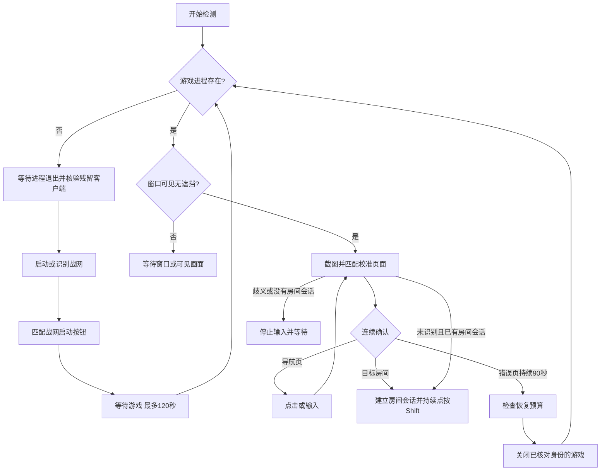

# 架构与协议

版本 0.3.0，目标为 Windows 10/11 x64 国服战网版。实现独立于旧样本，只使用系统公开接口。

## 本地线程与资源

Win32 UI 线程处理按钮、校准、全局停止热键和状态刷新；工作线程每约 100 ms 检查焦点，每约 1 秒识别一次页面，每约 2 秒枚举进程。网络线程负责心跳，网络失败不阻塞游戏状态检测。

截图只取目标窗口的可见客户区；显式开启后台点按时，也允许无遮挡的后台游戏窗口。截图前后核对可见性与输入桌面；不读取被遮挡或最小化的画面。DC 和 DIB 按窗口尺寸复用；每个模板在归一化 ROI 中抽取 32×16 灰度值，每格 4 个采样点。匹配不引入 OCR、YOLO 或其他模型。手动校准最多 32 个模板，每份模板 512 字节，保存为 INI 中的十六进制文本。

国服预设不再编译进二进制，而是 `profiles/cn-16x9.json`：页面标识、动作、点击位置、宽高比、每条规则的阈值、每个锚点的 ROI 与阈值、以及模板字节都在文件里，加载顺序为配置目录覆盖 → exe 旁随包文件 → 内置回退副本。一个锚点可以带多份变体模板，任一变体达标即算通过：同一块界面在不同窗口像素尺寸下会抽出不同的 32×16 样本，变体表达的是一条要求在不同尺寸下的多次观察，而不是不同页面。规则必须每个锚点全部通过才算命中；两个互斥页面的分差不足时判为歧义并放弃。

当前截图仍复制完整客户区。DIB 和帧缓冲合计约占 `宽 × 高 × 8` 字节，不含其他程序内存；这不是进程总内存的实测值。小窗口可以降低截图成本，缩放后的字体和 UI 仍需实机确认识别是否稳定。

## 识别与恢复

0.3.0 的 `core/cn_recovery.hpp` 提供可关闭的国服预设，与手动校准共同参与识别。错误页面需同时满足标志、错误文字和按钮区域，避免把普通蓝色加载页面当成掉线。浏览页需标题与目标模式名称都匹配，检查已选边框及橙色加入按钮；边框可能只是鼠标悬停，因此 `CNJoinGate` 还要求本轮成功发送目标选择动作，15 秒内再次确认后才加入。停止、进程变化、已知其他页面和一次加入尝试会撤销该证据。模板采用固定的小图灰度样本，不引入 OCR。

预设只支持已录到的约 16:9 布局及目标卡片位置。浏览页有小范围对齐补偿；战网图标与按钮按 DPI 和窗口左下锚点定位，二者同时匹配才启动。已知错误优先于手动模板；已知导航优先于手动 Ready，及时结束房间会话。其余手动模板优先，歧义仍暂停。

“重启游戏”按钮把一次请求绑定到当前运行代次，允许在暂停或缺配置状态重新发起；共用演练、身份核对、退出等待和恢复预算。关闭前检查客户端绝对路径及启动配置，失败时保留现有游戏。手动请求可在自动恢复关闭时执行一次恢复；F8 撤销旧代次。

战网进程存在但没有可见主窗口时，首次激活阶段也会打开配置的入口以唤起主窗口；120 秒截止时间防止重复拉起。窗口枚举从身份匹配的窗口中优先选择无所属窗口的大客户区，避免选到战网的微小辅助窗口。

模板记录目标对象、页面名称、ROI、宽高比、操作位置和操作类型。宽高比偏差超过 3.5% 的模板不参与匹配；相似度阈值默认 0.90。两个互斥合格模板的分差不足 0.025 时判为歧义，不执行动作。同一对象的 Ready 或 Restart 多个样本作为同类观察，用稳定观察编号连续两帧确认。Ready 模板在原位置得分不足 0.98 时最多尝试 24 个附近偏移（约 1024×576 客户区上 ±2 像素，随整数缩放步长变化）；导航与错误模板保持原位置匹配。

导航操作之间至少间隔 5 秒，同一页面最多尝试发送 3 次（包含失败或部分发送）；输入文字最多一次，避免重复提交。确认进入另一个页面后重置前页重试次数。房间会话在首次连续确认 Ready 后保留；未知画面不清除会话，已知导航/错误、歧义或进程变化立即清除。默认 keybd_event 左 Shift 点按，20 ms 后抬起，每约 1 秒发送一次。后台点按是全局事件，不能承诺后台游戏接收。持续按住模式和禁用后台选项时失焦释放；安全桌面始终暂停输入。每次开始和停止都会更新运行代次；输入接口在锁内核对代次，拒绝上一轮检测留下的动作。



游戏进程通过文件名、PID 与创建时间核对；发出关闭请求前再次检查。先发送 `WM_CLOSE`，等待最多 5 秒，再结束同一进程并最多等待 5 秒确认退出。游戏缺失时检查配置的 OWNeacClient.exe 路径，按打开的进程句柄核对路径和创建时间后才清理残留；权限或身份无法验证则暂停。首次缺失等待 30 秒，主动关闭后等待 3 秒，启动游戏等待期间不清理。连续 30 秒窗口无响应、进程存在 120 秒仍无主窗口，也会进入恢复流程。最多每滚动小时 3 次恢复，依次冷却 30/60/120 秒；该预算只在本次进程内保留。

启动与恢复节点请求前台切换。Windows 只在调用者持有前台锁时才允许切换，被拒绝时 `SetForegroundWindow` 只让任务栏图标闪烁，返回值不能作为成功依据，因此改为在 10 秒窗口内每秒重试并核对 `GetForegroundWindow`；直接切换失败时才临时 `AttachThreadInput` 借用前台线程的输入队列，用完立即断开。超时后写入日志并继续等待，不静默。国服预设、自动恢复开启且非演练时，若核实遮挡者是当前 Battle.net 主窗口并持续 5 秒，还会请求一次切回游戏；同一持续遮挡期间不重复。该分支对应昨晚战网恢复网络后主动弹窗的记录，不处理其他应用的遮挡。重启战网不等于重新完成账号认证；过期登录或验证码需人工处理。

助手、游戏、战网与 Neac 的完整性级别（`TokenIntegrityLevel` / `TokenElevation`）进入诊断报告。目标高于助手时 Windows 会拒绝向它发送输入和切换前台（UIPI），此时状态改为 `NEEDS_USER` 并说明需以管理员身份运行助手。助手不自动提权，也不模拟 UAC。

输入注入是全局的：`SendInput`/`keybd_event` 送达的是**当前焦点窗口**，与目标 HWND 无关。因此助手只在游戏位于前台时动作，后台既不点击也不截图、也不消耗截图预算——否则按键会落进用户自己正在用的程序。

待机判定建立在同一个事实上。`GetLastInputInfo()` 会把自己的注入也算作输入，所以"玩家在动"必须定义为**明显晚于助手最后一次发送**的输入（余量 400 ms）。一旦进入待机助手就不再注入，该时间戳随即变陈旧，若仍按同一规则判断就会永远认为玩家在忙、待机无法退出；因此待机期间改用"时间戳只要变化就是玩家"的状态机。玩家停止操作满 `standby_seconds` 秒后助手接管，该时长由界面设置并双向钳制在 3–600 秒。退出待机时同时刷新 `lastPlayerInput_` 与 `lastSend_`：前者不清会让刚结束待机的那次按键立刻把助手送回待机，后者不清则整段待机期间陈旧的发送时间戳会把玩家的最后输入读成"一直很新"。

安全桌面/锁屏期间发布 WAITING_DESKTOP，暂停输入和启动等待超时，清除连续错误证据；返回后重新检测。错误证据两次采样相隔超过 2.5 秒也重新累计。NeacProtect 授权仍需手动处理。

演练模式保留检测与状态上报，但不发送输入、启动或关闭游戏。演示模式用独立配置和 `owh-demo.exe` 进程，其错误页确认时间为 5 秒。

## 看板

Go 标准库服务内嵌静态网页。客户端普通心跳间隔 30 秒，状态变化加速上报且间隔不短于 2 秒。只上传状态文字、PID、运行时间、恢复次数和匹配分数；不上传截图、校准图像或游戏凭据。

| 接口 | 方法 | 认证 | 用途 |
|---|---|---|---|
| `/api/heartbeat` | POST | Agent Bearer 令牌 | 设备上报 |
| `/api/status` | GET | 查看 Bearer 令牌 | 完整状态快照 |
| `/api/events` | GET | 查看 Bearer 令牌 | SSE 快照，变化时推送并每 15 秒刷新 |
| `/healthz` | GET | 无 | 服务健康检查 |

心跳示例：

```json
{"machine":"pc-01","state":"ACTIVE","detail":"房间会话已确认，每秒请求点按左 Shift。","pid":1234,"uptime":3600,"restarts":1,"score":0.97,"dry_run":false,"version":"0.2.0"}
```

`seen` 由服务端接收时间生成，超过 90 秒没有心跳即显示离线。网页使用服务端时间加单调经过时间计算离线，避免浏览器系统时间偏差造成误判。查看令牌仅在网页内存中保留，刷新后需重新登录。

内存上限：128 台设备、200 条状态事件、32 个 SSE 查看连接。心跳正文最大 16 KiB。快照每 10 秒以临时文件替换方式保存到 `state.json`；正常退出时再保存。损坏快照会阻止启动并提示处理，不静默覆盖。

看板只读，不下发远程键鼠命令。服务端默认绑定 `127.0.0.1:8765`。远程部署应配置 HTTPS 反向代理，并允许 SSE 持续连接。

## 已知边界

此版尚未分离截图工作进程，无法保证恢复所有图形驱动阻塞或助手自身崩溃。原生窗口、输入、国服界面和权限兼容性需 Windows 实机验证。系统强制结束助手时没有机会执行按键释放；正常停止、失焦和退出路径会释放按键。
