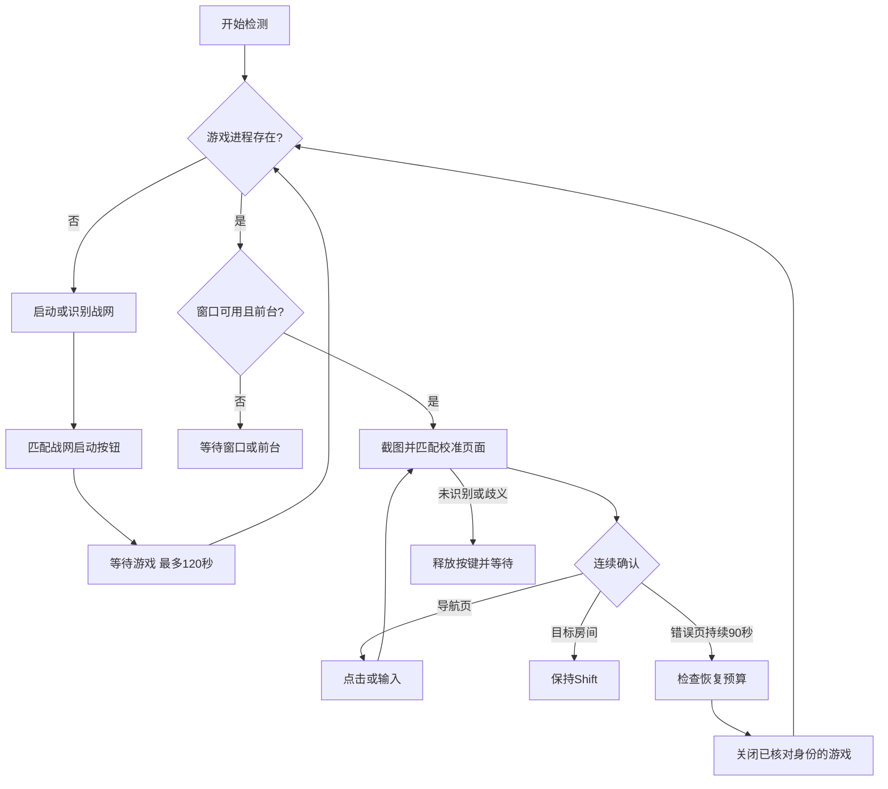

# 架构与协议

版本 0.1.0，目标为 Windows 10/11 x64 国服战网版。实现独立于旧样本，只使用系统公开接口。

## 本地线程与资源

Win32 UI 线程处理按钮、校准、全局停止热键和状态刷新；工作线程每约 100 ms 检查焦点，每约 1 秒识别一次页面，每约 2 秒枚举进程。网络线程负责心跳，网络失败不阻塞游戏状态检测。

截图只取当前前台目标窗口的可见客户区。DC 和 DIB 按窗口尺寸复用；每个模板在归一化 ROI 中抽取 32×16 灰度值，每格 4 个采样点。匹配不引入 OCR、YOLO 或其他模型。最多 32 个模板，每份模板 512 字节，保存为 INI 中的十六进制文本。

当前截图仍复制完整客户区。DIB 和帧缓冲合计约占 `宽 × 高 × 8` 字节，不含其他程序内存；这不是进程总内存的实测值。小窗口可以降低截图成本，缩放后的字体和 UI 仍需实机确认识别是否稳定。

## 识别与恢复

模板记录目标对象、页面名称、ROI、宽高比、操作位置和操作类型。宽高比偏差超过 3.5% 的模板不参与匹配；相似度阈值默认 0.90。两个合格模板的分差不足 0.025 时判为歧义，不执行动作。连续两帧匹配同一页面才确认。

导航操作之间至少间隔 5 秒，同一页面最多成功发送 3 次；输入文字最多一次，避免重复提交。确认进入另一个页面后重置前页重试次数。停止、焦点变化、无法截图或匹配失败都会释放本程序保持的 Shift。



游戏进程通过文件名、PID 与创建时间核对；发出关闭请求前再次检查。先发送 `WM_CLOSE`，等待最多 5 秒，再结束同一进程。连续 30 秒窗口无响应、进程存在 120 秒仍无主窗口，也会进入恢复流程。最多每滚动小时 3 次恢复，依次冷却 30/60/120 秒；该预算只在本次进程内保留。

启动与恢复节点各请求一次前台切换。Windows 有权拒绝；程序随后等待 `WAITING_FOCUS`，不循环抢焦点。重启战网不等于重新完成账号认证；过期登录或验证码需人工处理。

演练模式保留检测与状态上报，但不发送输入、启动或关闭游戏。演示模式用独立配置和 `owh-demo.exe` 进程，其错误页确认时间为 5 秒。

## 看板

Go 标准库服务内嵌静态网页。客户端普通心跳间隔 30 秒，状态变化加速上报且间隔不短于 2 秒。只上传状态文字、PID、运行时间、恢复次数和匹配分数；不上传截图、校准图像或游戏凭据。

| 接口 | 方法 | 认证 | 用途 |
|---|---|---|---|
| `/api/heartbeat` | POST | Agent Bearer 令牌 | 设备上报 |
| `/api/status` | GET | 查看 Bearer 令牌 | 完整状态快照 |
| `/api/events` | GET | 查看 Bearer 令牌 | SSE 快照，变化时推送并每 15 秒刷新 |
| `/healthz` | GET | 无 | 服务健康检查 |

心跳示例：

```json
{"machine":"pc-01","state":"ACTIVE","detail":"目标房间已确认，保持 Shift。","pid":1234,"uptime":3600,"restarts":1,"score":0.97,"dry_run":false,"version":"0.1.0"}
```

`seen` 由服务端接收时间生成，超过 90 秒没有心跳即显示离线。网页使用服务端时间加单调经过时间计算离线，避免浏览器系统时间偏差造成误判。查看令牌仅在网页内存中保留，刷新后需重新登录。

内存上限：128 台设备、200 条状态事件、32 个 SSE 查看连接。心跳正文最大 16 KiB。快照每 10 秒以临时文件替换方式保存到 `state.json`；正常退出时再保存。损坏快照会阻止启动并提示处理，不静默覆盖。

看板只读，不下发远程键鼠命令。服务端默认绑定 `127.0.0.1:8765`。远程部署应配置 HTTPS 反向代理，并允许 SSE 持续连接。

## 已知边界

此版尚未分离截图工作进程，无法保证恢复所有图形驱动阻塞或助手自身崩溃。原生窗口、输入、国服界面和权限兼容性需 Windows 实机验证。系统强制结束助手时没有机会执行按键释放；正常停止、失焦和退出路径会释放按键。
