# OverwatchHelper：低占用、可恢复的设计建议

这是依据 `ow.exe` 静态分析提出的新实现方案，不是已开发或通过实机测试的产品。目标是：检测游戏状态 → 必要时启动 → 确认大厅 → 返回指定自定义房间 → 执行可停止的输入任务，同时提供稳定的状态看板。

## 建议结构

优先考虑 C++20 + Win32 原生托盘/窗口面板。界面使用正常消息循环；后台监控与界面解耦。若开发效率优先，可以另选熟悉的桌面框架，性能以 Windows 实测为准。

核心拆成四个职责：

| 模块 | 职责 | 故障边界 |
|---|---|---|
| 状态管理器 | 唯一拥有状态、重试次数和截止时间；串行发出动作 | 禁止并发启动和重复重启 |
| 进程观察器 | 验证游戏路径、PID、创建时间与窗口归属；等待进程退出 | 区分没启动、启动中、有进程无窗口 |
| 界面操作器 | 识别战网页面、游戏大厅、目标房间；执行一个有截止时间的动作 | 截图/跨进程消息阻塞不能冻结看板 |
| 托盘与看板 | 显示状态、失败原因、下次重试、日志，提供开始/暂停/停止 | 不直接执行截图或进程等待 |

如必须采用可能阻塞的 `PrintWindow`，建议把取图放在可重启的独立辅助进程中，并禁止超时后持续创建新线程积累资源。Microsoft 明确说明该 API 可能同步阻塞。[PrintWindow 文档](https://learn.microsoft.com/en-us/windows/win32/api/winuser/nf-winuser-printwindow)

## 状态机

```mermaid
stateDiagram-v2
    [*] --> Stopped
    Stopped --> Detecting: 开始
    Detecting --> EnsureLauncher: 游戏不存在
    Detecting --> ObserveGame: 游戏已存在
    EnsureLauncher --> WaitLauncher: 发起一次启动
    WaitLauncher --> StartGame: 已登录且页面就绪
    WaitLauncher --> NeedsUser: 登录过期或需要验证
    StartGame --> WaitGame: 发起一次启动
    WaitGame --> ObserveGame: 游戏进程及窗口已确认
    ObserveGame --> JoinRoom: 已确认大厅
    ObserveGame --> Active: 已确认目标房间
    JoinRoom --> Active: 房间身份与加入结果通过校验
    Active --> Detecting: 进程退出或连接中断
    WaitLauncher --> Backoff: 超时
    WaitGame --> Backoff: 超时
    JoinRoom --> Backoff: 超时或房间不可用
    Backoff --> Detecting: 到达重试时间且未超上限
    Backoff --> NeedsUser: 达到重试上限
    NeedsUser --> Detecting: 用户处理后继续
    Active --> Stopped: 停止并释放输入
```

所有工作状态都应支持“停止”；图中只保留一条停止箭头以便阅读。

进程存在、窗口存在、大厅就绪和已经进入目标房间是四个不同条件。每个状态转换记录证据和原因，不依赖“窗口出现后固定等15秒”作为成功标准。

## 怎样降低计算资源占用

- 已持有游戏进程句柄时，在工作线程等待“进程退出事件 + 停止事件 + 有限超时”，避免每 15 ms 枚举窗口。`WaitForMultipleObjects` 可以同时等待这些句柄；创建窗口的 UI 线程应保留消息循环，或使用适合消息线程的等待接口。[Microsoft 文档](https://learn.microsoft.com/en-us/windows/win32/api/synchapi/nf-synchapi-waitformultipleobjects)
- 无游戏时，每 2–5 秒做一次轻量探测；启动和导航期间再临时提高识别频率。稳定房间状态可先从 0.5–1 Hz 取样测试，而不是持续近 60 Hz 截图。
- 复用 DC 与位图缓冲，只有尺寸改变才重建。优先捕获所需的小区域；若底层接口仍要求全窗取图，就限制频率，不能把后续裁剪称作降低了捕获成本。
- 把“输入动作调度”和“屏幕识别”分开计时；动作间隔等待停止事件，避免 `Sleep(1)` 循环。频率通过实际房间规则及状态验证确定。
- 看板只在状态变化时更新，运行时统计最多约每秒刷新一次；隐藏时停止不必要的绘制。日志使用有界缓冲并轮转文件。
- 使用 64 位单调时间源或 `std::chrono::steady_clock` 表达截止时间，避免样本的长期运行 `clock_t` 问题。

以上是初始设计参数，不是性能或成功率承诺。验收应分别记录“仅监控”“房间稳定运行”“重连导航”三种状态下的 CPU 时间、工作集、提交内存、句柄/GDI 对象数、截图次数与恢复耗时。

## 怎样让恢复与看板稳固

1. 启动器路径由配置和本机发现结果确定，校验后启动。先确认客户端发行渠道和当前版本；不要把样本中用于防火墙规则的 `OWNeacClient.exe` 路径当作游戏启动命令。
2. 将“战网已登录”作为可验证状态。需要验证码或登录交互时进入 `NeedsUser` 并显示原因，避免无限点击同一按钮。
3. 优先评估启动器可访问性元素；只有当前页面确实提供可靠元素时使用。否则使用可校准的局部特征识别，并绑定分辨率、DPI、语言和版本配置。
4. 每个操作都有截止时间、取消信号和后置验证。可用的跨进程同步消息加超时；不能用它假装给任意阻塞 API 增加超时。[SendMessageTimeoutW 文档](https://learn.microsoft.com/en-us/windows/win32/api/winuser/nf-winuser-sendmessagetimeoutw)
5. 重试采用有限退避，例如 5、15、30、60 秒；这是建议初值。达到上限后暂停并显示故障，不反复杀进程。
6. 窗口无响应、网络掉线、游戏更新和识别失败应分别处理。通过助手线程心跳只能证明助手是否有进展，不能单独证明游戏卡死。
7. 每次动作前重新验证窗口对应的进程及创建时间。不要让游戏与战网共用一个含义不断变化的全局窗口句柄。
8. 输入采用成对的按下/抬起，停止或切换状态时释放本程序仍持有的按键与鼠标按钮；前台动作要确认目标窗口，失去焦点则暂停该动作。

## 固定自定义房间：样本没有解决的部分

需要独立实现 `JoinRoom`，不能从“自由死斗”导航逻辑直接推出。配置至少包含：房间名/房主标识、加入方式、可选密码来源、进入后可验证的标识，以及房间不存在、已满或解散时的策略。

后续 Windows 实机采样需覆盖：大厅 → 自定义游戏 → 搜索/筛选 → 精确选中目标 → 加入 → 验证。每一步均应能判断“已成功”“仍加载”“需重试”“需人工处理”。密码不写入普通日志。只有确认进入指定房间后才开始输入任务。

看板应显示：当前阶段、已验证的游戏 PID、目标房间、连接/恢复原因、累计重试、下次重试时间、最近错误、最近状态转换和停止是否完成。保存少量失败诊断图即可，不持续录屏。

## 实机验收清单

| 场景 | 期望结果 |
|---|---|
| 战网与游戏都关闭 | 启动配置的战网；在有限时间内前进或明确停在错误状态 |
| 战网登录过期/验证 | 显示需要处理的原因；不产生启动或点击风暴 |
| 游戏进程在但窗口未出现 | 保持启动中，避免重复创建进程 |
| 游戏退出/连接中断 | 先确认状态，再有限重试；界面保持可操作 |
| 目标房间不存在、已满或改名 | 保留故障原因，按策略退避或暂停 |
| DPI/分辨率变化 | 重新标定或停止动作，不盲点旧坐标 |
| 截图卡住 | 看板及停止操作仍可响应，辅助进程能被收回 |
| 停止时有按键按下 | 释放输入并在有限时间内停止 |
| 8–24 小时运行 | 无持续增长的句柄、GDI 对象和内存；日志有界 |

样本中的管理员要求、防火墙修改、宿主进程内映像加载和原文件改写不构成上述架构的必要条件。新项目应仅引入已证明需要的权限和行为。
