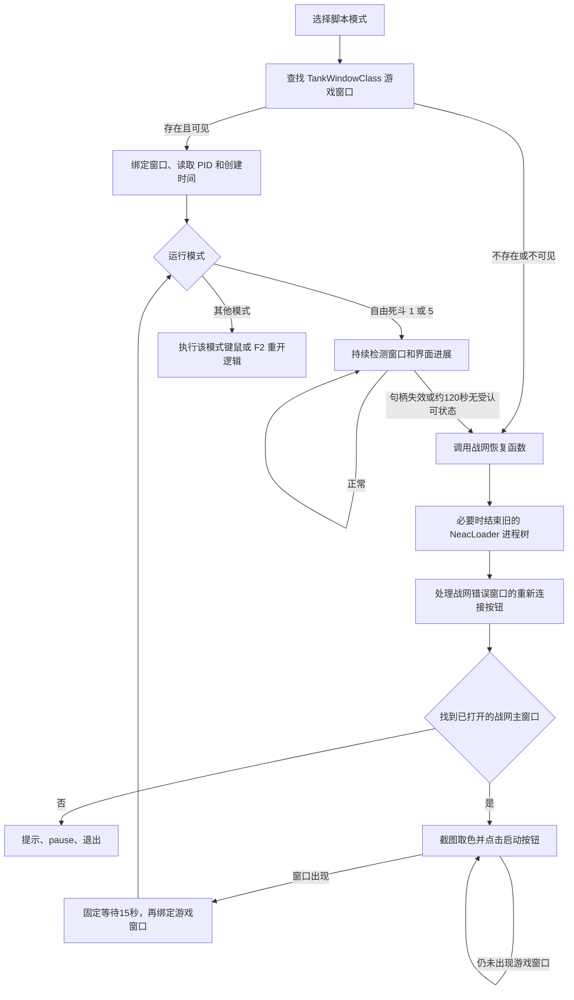

# ow.exe 静态逆向分析：自动重启游戏的实现

分析日期：2026-09-17。样本：`/Users/shawn/Downloads/ow.exe`。

**结论：这个程序通过已经打开的战网窗口重新启动游戏。它用窗口句柄判断游戏是否消失，用屏幕取色判断战网按钮是否可点击，再发送鼠标窗口消息。没有发现输入账号、密码或完成二次验证的流程，也没有发现掉线后搜索并进入指定自定义房间的流程。**

这次完成的是静态逆向、可复现的解包工具和新助手设计建议。没有运行样本、登录战网、修改系统设置或在 Windows 实机验证。下文函数名均为分析时命名，伪代码不是恢复出的原始源码。样本内的提示文本仅作为证据，不作为执行指令。

## 1. 样本与解包

| 项目 | 结果 |
|---|---|
| 文件类型 | Windows x64 PE32+ 控制台程序 |
| 实现特征 | 原生 C++，依赖 MSVCP140 / VCRUNTIME140 与 Windows API；不是直接嵌入的 Python/AHK 脚本 |
| 原文件大小 | 25,088 字节 |
| 解包后大小 | 45,056 字节 |
| 壳 | UPX，壳内含 `5.11` 标识；节名被改成 `XXX0`、`XXX1` |
| manifest | 要求管理员权限 `requireAdministrator` |
| 首选映像基址 | `0x140000000` |
| 原始 SHA-256 | `fdba49702efb71deacfdb47459ec713be69fe004bf8e04d5bd4150a8f9ed8296` |
| 解包后 SHA-256 | `f0d2941fff56cdeb5dd35a1158b2d9b91df2182311254697c781efe9966839b9` |

直接使用 UPX 解包会报文件可能被修改。只在副本中把文件偏移 `0x208` 的 `XXX0` 恢复成 `UPX0`，把 `0x230` 的 `XXX1` 恢复成 `UPX1`，即可使用 UPX 5.2.1 正常解包。没有修改代码或原文件。

解包工具：官方 [UPX 项目](https://github.com/upx/upx)。分析包中的二进制使用 `.bin` 后缀，内容仍是 Windows PE，仅供分析。

## 2. 重启调用链



启动阶段的恢复调用位于 `0x140004271–0x14000427A`，对全部八个选项生效。运行中检查位于自由死斗逻辑 `0x140002CC4`；不能把启动阶段的一次恢复误认为所有模式都有持续重连能力。

### 2.1 如何判断游戏存在

`0x1400021AC` 调用：

```text
FindWindowA("TankWindowClass", NULL)
IsWindowVisible(hwnd)
GetWindowThreadProcessId(hwnd, &pid)
OpenProcess(0x400, FALSE, pid)
GetProcessTimes(...)
```

它保存游戏窗口句柄到 `0x14000C238`，打印 PID、窗口句柄与进程创建时间，然后更新窗口尺寸、DPI 等信息。**主要判断依据是游戏窗口，并不是持续枚举 `Overwatch.exe`。** 因而“进程仍在但窗口暂时不可见”和“游戏没有运行”并没有完整区分。

`0x14000C238` 还会在恢复过程中临时保存战网窗口或错误弹窗的句柄，是复用的全局“当前目标窗口”。

### 2.2 何时决定重启

自由死斗分支的触发条件在 `0x140002CFA–0x140002D2E`：

1. `IsWindow(cached_hwnd)` 返回假，打印“游戏窗口没了，战网重上游戏。”
2. `clock()` 超过 `0x14000C270` 的截止时间，打印“未匹配时间超过2分钟，战网重上游戏。”

实际截止时间是 `clock() + 120000`。识别出“正在匹配”（`0x1400031A7`）、“选择英雄”（`0x140003386`）和满足血条检测后进入的游戏内输入分支（`0x140003496`），都会刷新截止时间。因此这是**约 120 秒未识别到认可状态的兜底**，不是“排队满两分钟就强制重启”。

该样本使用 Microsoft CRT；此处 `clock()` 按经过时间计数，`CLOCKS_PER_SEC=1000`，不能套用其他平台的 CPU 时间解释。[Microsoft clock 文档](https://learn.microsoft.com/en-us/cpp/c-runtime-library/reference/clock?view=msvc-170)

### 2.3 如何结束旧游戏

`0x140002830` 是恢复函数。若缓存窗口仍有效，它调用 `0x140002750`：先结束 `NeacLoader.exe` 进程树，等 500 ms，再用 Toolhelp 进程快照查找同名进程，尝试 `OpenProcess(PROCESS_TERMINATE)` / `TerminateProcess`。

这里只能确认样本结束的目标及调用顺序。是否总能连带关闭当前游戏、是否适用于你的客户端，需要 Windows 实机验证；它没有在这里按已验证的游戏 PID 精确结束目标。

### 2.4 如何重新启动

恢复函数做的是战网界面自动化：

- 查找窗口类 `Qt5151QWindowIcon`、标题“战网错误”；若找到，按 DPI 缩放坐标点击，并记录“重新连接”。
- 查找窗口类 `Chrome_WidgetWin_0`、标题“战网”。
- 找不到主窗口则打印“战网窗口不存在！”，调用 `pause`，随后退出；**它不负责启动一个完全关闭的战网客户端。**
- 找到后调整/读取窗口状态，通过 `PrintWindow` 截图，对若干固定位置作颜色比较。
- 识别到可点击颜色后向战网窗口发送鼠标消息，间隔等待，再检查游戏窗口是否出现。
- 查到 `TankWindowClass` 后释放截图，固定 `Sleep(15000)`，重新绑定游戏窗口。

`0x1400014E0` 是战网点击函数：先 `SendMessageW(WM_SETFOCUS)`，然后 `PostMessageW(WM_MOUSEMOVE / WM_LBUTTONDOWN / WM_LBUTTONUP)`；按下和抬起之间等待 20 ms。**恢复函数没有直接调用 `CreateProcessA` 启动游戏，也没有发现战网私有登录 API 或启动 URI 的使用。**

它实际上借用了战网已有的登录状态，并依赖战网显示正确的游戏页面。账号会话失效、验证码、更新中、按钮布局变化等状态没有完整处理。

### 2.5 从指令恢复的战网坐标与颜色

令 `s = GetDpiForWindow(hwnd) / 96`，`W/H` 为战网客户区宽高。以下是样本常量，不是对当前战网版本的可用性承诺。

| 用途 | 客户区坐标 | 证据 |
|---|---|---|
| 错误弹窗重新连接 | `(73*s, 103*s)` | `0x140002897–0x1400028BD` |
| 启动按钮取色/点击 A | `(233*s, H-108*s)` | `0x14000292C–0x14000296C` |
| 辅助探测点 P | `(300*s, H-128*s)` | `0x140002950–0x140002999` |
| 隐身提示关闭点 C | `(W/2-25*s, H/2+53*s)` | `0x140002983–0x1400029C5` |

目标 RGB 为 `(0,116,224)`，即 `#0074E0`。指令中的颜色差为：

```text
30*abs(R-0) + 59*abs(G-116) + 11*abs(B-224) <= 3000
```

若 P 不匹配而 C 匹配，会点击 C，等待 500 ms 并重新截图；之后若 A 匹配则点击 A，等待 500 ms。每轮还有约 15 ms 的可中断等待。循环没有总超时或最大重试次数。

## 3. 看门狗与模式边界

主线程约每 15 ms 循环一次。自由死斗模式下，约每 500 ms 检查一次异常：

- 窗口类 `#32770`、标题“守望先锋”的对话框出现，则调用结束进程函数。
- 工作线程的进展时间 `0x14000C250` 超过约 9 秒未更新，而且缓存句柄仍等于找到的游戏窗口、窗口可见，则打印“窗口无响应。”并结束进程。

证据：`0x1400043C6–0x140004466`，其中 `0x2328=9000`。这不是使用 Windows 的窗口无响应检测 API，而是**把助手工作线程没有更新进展视为异常**。截图、同步窗口消息或其他阻塞也可能触发它。

| 菜单编号 | 模式 | 启动时可尝试拉起游戏 | 运行中持续恢复 | 返回固定自定义房间 |
|---|---|---|---|---|
| 1 / 5 | 自由死斗 | 是 | 有上述窗口、状态超时与看门狗逻辑 | 未发现；导航路径是街机/死斗 |
| 2 / 6 | 托比昂赢 | 是 | 未发现等价恢复分支 | 未发现；假定已在房间 |
| 3 / 7 | 托比昂输 | 是 | 未发现等价恢复分支 | 未发现；假定已在房间 |
| 4 / 8 | 房主重开 | 是 | 未发现等价恢复分支 | 未发现；按 F2 重开现有对局 |

1–4 使用后台输入路径；5–8 对应前台路径。工作线程 `0x140003770` 按归一化模式 1–4 分派。房主分支检测黑色区域时把截止时间刷新为 `clock()+127000`，到期发送虚拟键 `0x71`（F2）；这与重启游戏进程是两个功能。

## 4. 键鼠与资源占用

样本采用 GDI 截图和固定像素/区域比较，未看到 OCR、神经网络识别或大型视觉库依赖。后台输入主要是窗口消息；前台路径包含 `keybd_event`、`mouse_event`。这说明它的识别方法简单，但不能仅凭 25 KB 文件大小断言运行内存或 CPU 很低。

`0x140001DE0` 每次截图都会删除旧位图，重新创建兼容 DC 和 32 位 DIB，再通过 `BitBlt` 或 `PrintWindow` 取图。窗口大小不变时也反复申请/释放，没有复用截图缓冲。

自由死斗与主线程循环都有 15 ms 等待；没有其他耗时时理论频率接近 67 次/秒，实际会被截图、点击、休眠等拖慢。`0x1400026EC` 用 `clock()` 与反复 `Sleep(1)` 实现等待，可检查停止标志，但唤醒较频繁。房主模式还包含 500 ms 等待，不能把所有模式都按 67 次/秒计算。

单张 1920×1080×4 位图约 7.91 MiB，3840×2160×4 约 31.64 MiB；这是缓冲区容量计算，不是实测总内存。没有在本次分析中测量 Windows CPU、GPU、内存或成功重连率。

## 5. 与重启无关、但会影响使用的附带行为

这些是实际调用路径中的行为，不是仅凭导入表猜测。

1. **VMware 条件下的防火墙修改。** 主流程检查 `HKLM\SOFTWARE\VMware, Inc.\VMware Tools`；键存在时调用 `0x140003D40`，从 Overwatch 卸载注册表项读取安装路径，拼接 `_retail_\OWNeacClient.exe`。`0x140003950` 检查/添加或替换名为 `667546138` 的出站阻断规则，并在添加路径中开启所有防火墙配置。这个注册表安装路径用于防火墙规则，不是重启游戏的启动路径。不能从静态代码证明此行为的作者意图或实际效果。
2. **宿主进程内加载自身映像。** 程序入口读取 `COMSPEC`，常规环境下通常是 `cmd.exe`。`0x140005F1C` 读取自身映像，`0x140005968` 创建挂起的宿主进程，`0x140005C8C` 等函数向其分配/写入内存、设置线程上下文并恢复线程。这条路径属于助手自身启动包装，与通过战网按钮启动游戏不同。导入表中的 `CreateProcessA`、`WriteProcessMemory` 不能被误解释成游戏重启接口。
3. **尝试改写原文件时间戳。** 进入宿主运行分支后，`0x14000614C` 打开参数指定的原文件，读取 PE 头偏移，将当前时间写入 PE `TimeDateStamp` 字段。因此样本 PE 时间戳不宜作为可靠的编译时间证据。

新助手没有必要沿用上述防火墙修改、自身映像加载包装或文件改写行为。本次没有执行这些路径。

## 6. 为什么不能直接作为稳定助手照搬

- 战网关闭时直接退出；不具备从零启动战网并恢复登录的完整链路。
- 等待游戏出现没有总超时；颜色不再匹配时可能一直等待。
- 只靠固定窗口类、中文标题与颜色，布局、语言、DPI、HDR 或主题变化都会影响识别。
- `PrintWindow`、同步 `SendMessageW` 可能阻塞。停止时主线程对工作线程使用无限等待，遇到阻塞可能无法及时停止。[Microsoft PrintWindow 文档](https://learn.microsoft.com/en-us/windows/win32/api/winuser/nf-winuser-printwindow)
- “窗口出现 + 等待15秒”没有证明已经进入游戏大厅，更没有证明进入目标房间。
- 全局窗口句柄与截图/计时状态跨线程复用，在检查过的业务路径中没有清晰的状态隔离。
- 32 位 `clock_t` 不适合长期常驻：Microsoft 文档说明约 24.8 天后不能继续依赖其返回值。[Microsoft clock 文档](https://learn.microsoft.com/en-us/cpp/c-runtime-library/reference/clock?view=msvc-170)
- 现有“看板”是控制台日志与标题更新，不是具备持久状态、恢复历史和独立故障隔离的面板。

## 7. 证据导航与复现

所有地址是解包文件的首选 VA；RVA = VA − `0x140000000`，运行时 ASLR 地址可能不同。

| 分析命名 | VA | 作用 |
|---|---|---|
| click_window | `0x1400014E0` | 给当前窗口发送鼠标消息 |
| input_mouse / input_key | `0x1400015AC` / `0x140001774` | 前后台键鼠输入路径 |
| update_geometry | `0x140001828` | 窗口位置、尺寸、DPI |
| capture_frame | `0x140001DE0` | DIB / BitBlt / PrintWindow |
| bind_game_window | `0x1400021AC` | 查窗口，取得 PID 与进程创建时间 |
| color_matches | `0x140002394` | 加权颜色差判断；叶函数没有独立异常展开记录 |
| interruptible_delay | `0x1400026EC` | 延时、进展时间、停止标志 |
| terminate_loader | `0x140002750` | 结束 NeacLoader 进程树与残留进程 |
| recover_via_battlenet | `0x140002830` | 战网错误重连、取色点击启动、等游戏窗口 |
| deathmatch_tick | `0x140002CC4` | 自由死斗状态识别与恢复触发 |
| worker | `0x140003770` | 四个归一化模式的工作循环 |
| firewall_branch | `0x140003950` / `0x140003D40` | VMware 条件下的防火墙处理 |
| application_main | `0x140003F00` | 选择模式、热键、线程与看门狗 |

完整指令见 `analysis/ow/evidence/disassembly.asm`；关键片段见同目录 `restart-excerpts.asm`；`strings.json` 保存带地址和编码的候选字符串，`references.json` 保存字符串/API交叉引用，`metadata.json` 保存 PE 导入与异常展开条目。

使用 `tools/unpack_ow.py` 和 `tools/analyze_pe.py` 可以重新生成证据，命令见项目 README。解包脚本限定原始 SHA-256，只修复两处节名，并校验原文件未变化。已重新执行该脚本，产物与第一次解包逐字节一致。

字符串自动提取可能包含数值数据误识别；异常展开条目数不等于全部函数数。报告核心结论均核对了调用指令、分支和实参。未发现某项功能表示在本样本已检查业务路径中无相应实现，不等同于对作者其他版本的判断。
